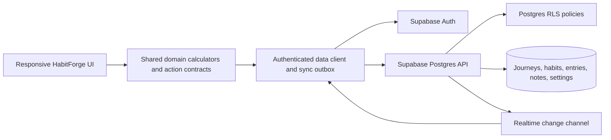
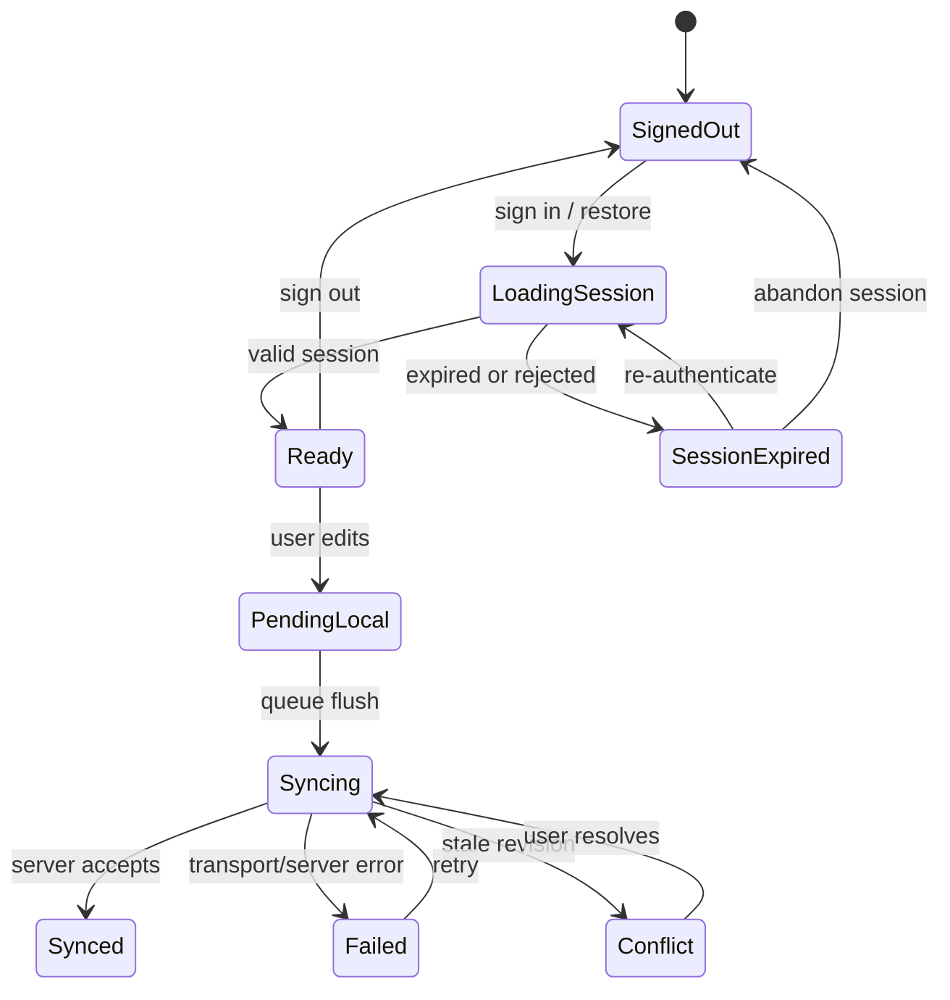

## Goal Capsule

**Objective:** HabitForge gives a user a trustworthy three-month habit journey that behaves consistently on desktop and mobile, preserves the supplied forge aesthetic, and keeps the user's habit data private and synchronized across devices.

**Target workspace:** Implement all application code, tests, migrations, assets, and configuration directly in the local `HabitForge` folder that contains this plan.

**Means:** Convert the static prototype surfaces into one responsive application with shared domain calculations, Supabase Auth/Postgres/RLS persistence, explicit sync states, and browser-first validation across representative desktop and mobile contexts (KTD1, KTD2, KTD3).

**Authority:** The frozen visual contract in `reference/design/DESIGN.md` and the product requirements below outrank prototype copy, fixture data, and embedded scripts. Security and data ownership rules outrank convenience.

**Stop conditions:** Do not ship while journey dates, ownership policies, sync status, or desktop/mobile behavior are contradictory; do not alter the visual language to hide a functional or responsive defect.

**Execution profile:** Characterization-first for the supplied prototype behavior, then contract-first implementation for domain calculations and RLS, followed by responsive browser verification.

**Finishes:** The implementation agent owns code, migrations, tests, and local verification; release approval remains with the project owner.

---

## Product Contract

### Summary

HabitForge is a private habit tracker for a user forming habits over a calendar-based three-month journey. It provides a dashboard for progress and a daily tracker for recording habit completion, while making the existing dark forge visual system a stable product identity rather than a disposable prototype theme.

### Problem Frame

The supplied archive is a collection of static desktop and mobile screens with divergent fixtures, incomplete handlers, simulated sync messages, and no durable data model. Copy and controls imply several incompatible interpretations of the journey, so directly wiring the prototype would preserve defects and make later synchronization unreliable.

### Requirements

- R1. The product is branded as HabitForge in visible headings, metadata, navigation, notifications, footer text, and test fixtures; legacy Wynter Arc, Mastery Division, Google Sheets, and Apps Script identity is removed or explicitly retained only in migration notes.
- R2. The visual aesthetic remains materially unchanged: dark layered surfaces, crisp borders, restrained amber/ember completion states, frost-cyan telemetry, Plus Jakarta Sans, JetBrains Mono, compact squared controls, and the documented spacing and responsive composition.
- R3. A signed-in user can create and use a calendar-based journey whose start date is Day 1 and whose end boundary is exclusive at the same calendar date three months later, evaluated in the journey's IANA timezone.
- R4. A user can view the dashboard and daily tracker for a selected journey date, with the same underlying habit and completion data driving counters, progress, streaks, group summaries, charts, and heatmap states.
- R5. A user can create, edit, archive, reorder, and group habits with a frequency, optional target time, active date range, and stable identity; historical completion records remain attributable to the habit version that existed when they were recorded.
- R6. A user can mark individual habits complete or incomplete for a selected local date, mark all eligible habits complete, reset the date, and add or update a daily note; repeated actions are idempotent.
- R7. Threshold, streak, grace-token, weekly quota, and campaign-progress rules are represented by one shared calculation contract rather than hard-coded per-page counters.
- R8. The interface reports truthful persistence states: local change pending, syncing, synced, failed, conflict requiring resolution, signed out, and session expired; it never claims Google Sheets or Supabase synchronization before a real backend operation succeeds.
- R9. Each user's habits, completions, notes, settings, and derived reads are private to that user; client-provided user IDs cannot widen access.
- R10. Authenticated data can be recovered on another device, and concurrent edits converge through a deterministic conflict policy without silently losing a completed habit entry.
- R11. Desktop, tablet, mobile portrait, and mobile landscape layouts preserve the visual contract and equivalent core behavior; mobile-specific navigation and density changes are intentional responsive variants, not separate product implementations.
- R12. The application exposes accessible names, keyboard focus, usable touch targets, visible focus states, and non-color status cues without changing the established aesthetic.

### Key Decisions

- K1. **HabitForge is the product name.** (session-settled: user-directed — chosen over the existing Wynter Arc identity: the user explicitly requested the rename.)
  - Governs R1.
- K2. **The visual system is frozen while behavior may change.** (session-settled: user-directed — chosen over redesigning the supplied screens: the user wants the current aesthetic preserved, not the prototype behavior copied.)
  - Governs R2, R11, R12.
- K3. **Journeys use a calendar-based three-month interval with an inclusive start and exclusive anniversary boundary.** (session-settled: user-directed — chosen over a fixed 90-day campaign and a calendar-quarter model: the user selected calendar-based duration and then selected the exact boundary rule.)
  - Governs R3, R4, R7.
- K4. **The first real product supports private accounts and cross-device sync.** (session-settled: user-directed — chosen over local-only or unauthenticated persistence: the user selected accounts with private cross-device sync.)
  - Governs R8, R9, R10.

### Actors

- A1. Signed-in user: owns journeys, habits, completions, notes, and settings.
- A2. Browser client: renders responsive views and submits authenticated changes.
- A3. Supabase Auth/Postgres/Realtime: authenticates identity, enforces ownership, persists records, and informs other active devices.

### Key Flows

- F1. **Start or resume a journey:** user signs in, selects or creates a journey, sees the current local date in the journey timezone, and receives the dashboard read model.
- F2. **Record a daily strike:** user selects a date, toggles one or more eligible habits, optionally adds a note, and sees derived metrics update after the authoritative write is accepted.
- F3. **Use another device:** a second signed-in browser opens the same journey and receives the same habit/completion state; a change on either device is reconciled without cross-user exposure.
- F4. **Recover from sync failure:** the browser distinguishes local pending work from server-confirmed state, retries safely, and surfaces a conflict or session-expiry action instead of showing a false success.

### Acceptance Examples

- AE1. **Calendar boundary:** Given a journey starts on 2026-01-15 in `Asia/Kolkata`, dates from 2026-01-15 through 2026-04-14 are eligible and 2026-04-15 is outside the journey.
- AE2. **Shared metrics:** Given the tracker marks 8 of 11 eligible habits complete, the dashboard and tracker show the same numerator, denominator, percentage rounding, and threshold status after reload.
- AE3. **Private ownership:** Given two authenticated users, a request made with user A's session cannot select, insert, update, or delete user B's journey data.
- AE4. **Idempotent retry:** Given a completion write is retried after a timeout, the selected habit/date has one final completion record, not duplicates or a doubled count.
- AE5. **Parity:** Given the same seeded account and journey, the core mark/reset/date-selection flows work on desktop and mobile, with only the documented responsive navigation and density differences.

### Success Criteria

- No visible product surface or automated fixture uses the legacy brand/provider language after the rename pass.
- All core flows have automated browser coverage in at least one desktop and one mobile project, plus a tablet breakpoint smoke case.
- A visual regression baseline covers the supplied aesthetic at stable desktop and mobile viewports, with dynamic telemetry and timestamps masked or frozen.
- RLS tests prove allow/deny behavior for every user-owned table and operation.
- Derived metrics are covered by deterministic fixtures at journey start, month boundaries, threshold boundaries, missed days, archived habits, and journey end.

### Scope Boundaries

#### Deferred for later

- Push reminders, email reminders, calendar integrations, social sharing, public profiles, gamification beyond the existing progress language, exports/imports, and an admin console.
- Provider migration tools for the prototype's Google Sheets or Apps Script labels.
- Advanced conflict merge UI beyond the smallest user-visible resolution needed for concurrent edits.

#### Outside this product's identity

- A redesign, light theme, playful arcade treatment, pill-heavy component language, or decorative visual system that conflicts with `reference/design/DESIGN.md`.
- Sharing or ranking another user's private habit data.

### Dependencies

- A JavaScript application runtime and test runner must be selected during implementation because the workspace currently contains only the attached static archive.
- A Supabase project or local Supabase CLI environment is required for Auth, Postgres migrations, Realtime configuration, and RLS tests.
- Stable local font/icon/image assets or a controlled asset proxy are required before visual baselines are trusted.

### Sources

- `reference/design/DESIGN.md` — extracted from the attached archive's `winter_arc_forge/DESIGN.md`; visual authority.
- `reference/prototype/dashboard-desktop.html` — extracted from `dashboard_the_wynter_arc/code.html`; desktop dashboard evidence.
- `reference/prototype/dashboard-mobile.html` — extracted from `dashboard_the_wynter_arc_mobile/code.html`; mobile dashboard evidence.
- `reference/prototype/tracker-desktop.html` — extracted from `daily_tracker_the_wynter_arc_desktop/code.html`; richer desktop tracker evidence.
- `reference/prototype/tracker.html` — extracted from `daily_tracker_the_wynter_arc/code.html`; alternate tracker evidence.
- `reference/prototype/tracker-mobile.html` — extracted from `daily_tracker_the_wynter_arc_mobile/code.html`; mobile tracker evidence.
- Supabase password authentication: https://supabase.com/docs/guides/auth/passwords
- Supabase Row Level Security: https://supabase.com/docs/guides/database/postgres/row-level-security
- Supabase Postgres Changes: https://supabase.com/docs/guides/realtime/postgres-changes
- Playwright device emulation: https://playwright.dev/docs/emulation
- Playwright visual comparisons: https://playwright.dev/docs/test-snapshots

---

## Planning Contract

### Key Technical Decisions

- KTD1. **Use one responsive component tree with shared domain services.** The archive has separate desktop/mobile HTML trees with different controls and semantics; duplicating them would preserve drift. CSS/layout variants may change density and navigation, but date selection, habit actions, metrics, sync state, and authorization must be shared.
- KTD2. **Use Supabase Auth, Postgres, RLS, and narrowly scoped Realtime subscriptions as the selected backend baseline.** The prototype and research support this choice for private accounts, database-enforced ownership, and cross-device updates. Runtime selection may choose the surrounding JavaScript framework, but it must not replace the Supabase boundary without revisiting the product contract.
- KTD3. **Make the domain calculation contract the source for both views and persistence reads.** Raw completions and habit definitions are authoritative; percentages, streaks, quotas, group counts, and journey progress are derived, not independently editable counters.
- KTD4. **Use journey-local dates and an explicit IANA timezone.** Date-only records use the user's journey-local calendar date; server timestamps remain audit metadata. All boundary and streak tests must exercise daylight-saving and non-UTC offsets.
- KTD5. **Use idempotent per-journey/habit/date writes with deterministic optimistic synchronization.** Enforce a unique key for one completion per habit/date, queue offline mutations with an operation identity, and use server revision/updated-at comparisons to detect stale writes. Default non-destructive resolution is last accepted revision for the same field, with a visible conflict state when both devices changed the same note or habit definition.
- KTD6. **Treat prototype copy and fixtures as defect evidence, not contracts.** Examples such as “Day 42 of 92,” 2024/2026 mixtures, Google Sheets to Supabase labels, and simulated latency must be replaced by canonical data and truthful states rather than preserved for visual similarity.
- KTD7. **Use browser-first proof with Playwright projects for desktop, tablet, and mobile.** Playwright device emulation supplies viewport/touch contexts, and screenshot assertions can protect the frozen visual contract; dynamic regions must be masked or seeded deterministically.
- KTD8. **Keep external assets from making correctness depend on the network.** Fonts, icons, and hero images should be self-hosted or have deterministic fallbacks; test offline and blocked-asset states so the interface remains usable and does not silently collapse.
- KTD9. **Keep the implementation boundary local and the visual reference immutable.** All source, generated assets, migrations, configuration, tests, and build output belong under the local `HabitForge` folder. The copied prototype and design files under `reference/` are read-only inputs; runtime code may consume their documented visual contract but must not mutate or import prototype behavior as product logic.
- KTD10. **Enforce ownership and synchronization invariants at the data boundary.** Child records derive ownership from their parent rather than accepting client-supplied owner fields; completion/reset batches are atomic and idempotent; outbox operations are isolated by immutable user ID and operation ID; session changes pause replay and subscriptions until ownership is revalidated.
- KTD11. **Preserve historical habit meaning with immutable versions.** A calculation-relevant habit edit creates a new immutable habit version with effective dates; entries retain the version active when recorded. Reordering and grouping do not rewrite historical versions, and archiving blocks new writes while preserving historical versions and entries.
- KTD12. **Use authoritative server commands for batch and conflict semantics.** Mark All and Reset execute transactionally through an authenticated server-side command boundary with durable operation receipts, payload-hash validation, monotonic revisions/tombstones, and an authoritative retry result. Realtime is a notification and invalidation channel; reconnect always performs an authorized snapshot or revision-based reconciliation.

### High-Level Technical Design

The client loads a journey read model, applies local optimistic changes through the domain action contract, persists idempotently, and reconciles server responses or Realtime invalidation events. A reconnect or missed-event window requires an authorized snapshot or revision-based refresh before live updates resume. The dashboard and tracker subscribe to the same normalized state and derived metrics rather than maintaining separate counters.

### Data Model Direction

- `journeys`: owner, name, start date, exclusive end date, IANA timezone, lifecycle state.
- `habit_groups`: owner/journey ownership, name, display order.
- `habits`: owner/journey/group ownership, stable identity, display order, lifecycle state.
- `habit_versions`: immutable habit label, frequency rule, target time, group, active range, calculation-relevant settings, effective dates, and version revision.
- `daily_habit_entries`: journey, habit, immutable habit version, local date, completion state, completion timestamp, revision metadata, unique journey/habit/date key.
- `daily_notes`: journey, local date, body, revision metadata.
- `user_journey_settings`: journey, threshold, grace-token and quota settings, calculation version.
- `operation_receipts`: immutable user and operation identity, payload hash, target scope, authoritative result, revision, and completion status for idempotent server commands.

Every exposed user-owned table receives explicit grants, RLS policies for select/insert/update/delete, and policy tests. Child policies must verify parent ownership and journey consistency; owner fields are immutable or derived server-side. Service-role operations, if later required, stay server-side and are not exposed to the browser. Notes are bounded plain text, escaped on output, and never interpreted as HTML.

Owner and parent keys require explicit `USING` and `WITH CHECK` coverage for every insert/update policy, database-enforced immutability or derivation, and negative tests for reassignment. Batch functions are `SECURITY INVOKER` where possible; any `SECURITY DEFINER` function must harden `search_path`, qualify objects, restrict `EXECUTE`, derive `auth.uid()` internally, and validate every supplied identifier.

### Research-Grounded Constraints

- Supabase's RLS guidance requires policies and grants together, with separate operation coverage and tests; enabling RLS alone is not sufficient.
- Realtime subscriptions must be scoped to the relevant data and remain subject to the application's ownership model; subscription cleanup is part of route/session lifecycle.
- Playwright visual snapshots are environment-sensitive; baselines must be generated and reviewed in the same controlled browser/OS environment, with dynamic content stabilized.
- The current workspace has no runtime manifest, test setup, backend, or repository conventions; implementation must establish these explicitly rather than pretending the static archive is already an application.

### Sequencing

1. Preserve the archive as reference material and establish the application/runtime/test skeleton.
2. Define calendar journey, immutable habit-version, habit frequency, threshold, streak, grace-token, quota, timezone, batch, and conflict contracts with fixture tests.
3. Freeze the domain/schema contract, then add Supabase migrations, Auth integration, grants/RLS policies, and database policy tests.
4. Pass the ownership, session-expiry, and sync-truthfulness gates before treating UI integration as release-ready.
5. Build the shared shell, tracker, dashboard, and truthful sync state using the frozen design tokens.
6. Add responsive/accessibility hardening and deterministic asset handling.
7. Run browser flows, visual comparisons, offline/error tests, migration rollback checks, and cross-device reconciliation checks; fix defects by category without redesigning the aesthetic.

### Assumptions

- The product will use a modern JavaScript/TypeScript frontend with Supabase; the framework and package manager are selected in U1 because no manifest exists, but the backend boundary is not reopened.
- The first journey supports daily, selected-weekday, and weekly-quota frequency rules; weekly periods are defined in the journey timezone, target time is display-only, and calculation-relevant edits create new versions before schema migration.
- Historical editing is allowed for dates inside the journey, but future dates and archived habits are not silently treated as completed.
- Last-write-wins is acceptable for identical scalar fields when revision metadata is available; same-record conflicts that could erase a user's note or completion are surfaced rather than hidden.
- Notes are plain text with explicit length limits; HTML, script-like markup, and automatic URL interpretation are not supported.
- Journey timezone and start boundary become immutable after the first entry, or require an explicit migration path that recomputes affected records.
- Habit calculation-relevant edits create immutable versions; the implementation must not reinterpret historical entries through a mutable current habit row.
- Conflicts present the local and server values and require an explicit keep-local or keep-server choice. Completion/reset races follow the same visible decision path and never silently erase a completed entry.

### System-Wide Impact

- Authentication and RLS affect every read/write path and require negative security tests, not only happy-path UI tests.
- Shared metric calculations affect dashboard, tracker, heatmap, streak display, and any future API response; version the calculation contract if its rules change.
- Responsive shell changes affect route navigation, safe-area behavior, keyboard focus, and screenshot baselines across all surfaces.
- Replacing CDN assets affects build packaging, loading states, and visual baseline reproducibility.
- Child-record ownership checks, session transitions, and Realtime teardown must be tested as one lifecycle; a local optimistic state is never treated as server truth.
- Schema rollout must be expand/contract where needed, with preflight orphan/duplicate checks, backup verification, lock-timeout rules, and a tested rollback or forward-fix path on a production-like snapshot.
- Journeys are archived rather than hard-deleted in the first release; account deletion is hard deletion with descendant purge, session revocation, browser-state cleanup, and replay prevention.
- Read-model caches, outbox records, service-worker caches, and rendered state must be namespaced by immutable user ID, session generation, and journey ID; account switching clears or quarantines prior-user state before loading the next account.
- Runtime assets are self-hosted by default. If an external asset remains, an exact origin allowlist, CSP, referrer policy, integrity/version pinning where applicable, and bundle/source-map scans for privileged secrets are required.

### Open Questions

- **Runtime baseline:** Select the JavaScript framework, package manager, TypeScript/build tooling, Supabase CLI version, local auth seed strategy, and pinned Playwright/browser/OS baseline in U1.

### Risks & Dependencies

- Calendar boundary mistakes can corrupt every metric; resolve date arithmetic in pure tests before UI wiring.
- Prototype fixture years and provider labels can leak into production; use a rename/search gate over source, tests, metadata, and seed data.
- Realtime events can duplicate local optimistic updates; reconcile by stable record ID and revision, not by blindly incrementing counters.
- Offline queues can replay after logout; bind queued operations to the authenticated user/session and discard or quarantine them on account change.
- Visual snapshot churn can conceal functional changes; mask timestamps, animations, remote telemetry, and random IDs while keeping layout and copy assertions strict.

---

## Implementation Units

### U1. Establish the HabitForge application and visual reference

**Goal:** Import the supplied archive as traceable reference material and create the application shell, asset strategy, shared design tokens, and route structure without changing the established visual language.

**Requirements:** R1, R2, R11, R12; K1, K2.

**Dependencies:** None.

**Files:** `reference/design/DESIGN.md`, `reference/prototype/*.html`, `src/app/`, `src/components/shell/`, `src/styles/tokens.*`, `src/assets/`, `tests/visual/reference-loading.*`.

**Approach:**

1. Copy the archive's design brief and five HTML surfaces into `reference/` for traceability, mark the directory read-only by convention, and never use it as runtime behavior.
2. Centralize colors, typography, spacing, radii, borders, and responsive breakpoints from the design brief.
3. Build one route-aware shell with desktop header navigation and mobile bottom navigation as responsive variants.
4. Replace remote-only fonts, icons, and hero images with packaged assets or deterministic fallbacks while preserving their rendered role.
5. Add HabitForge branding and remove legacy provider/product identity from runtime surfaces.

**Patterns to follow:** `reference/design/DESIGN.md`; shared shell primitives; CSS-driven responsive composition rather than separate page trees.

**Execution note:** Start with characterization screenshots and DOM landmarks from the supplied desktop/mobile references before replacing the static markup.

**Test scenarios:**

- Load dashboard and tracker routes with assets available; the expected shell, fonts, colors, navigation landmarks, and branding render.
- Block font and hero-image requests; fallback assets preserve layout, readable text, and actionable controls.
- Render at desktop, tablet, mobile portrait, and mobile landscape widths; shell navigation changes only as specified by responsive rules.
- Navigate with keyboard through header/bottom navigation, settings, and primary content; focus is visible and no control is unreachable.
- Search built assets, metadata, and user-facing strings; legacy branding/provider terms are absent except in reference documentation.

**Verification:** A single responsive shell renders both routes, visual reference checkpoints are available, and the visual token source is centralized instead of duplicated in each page.

**Gate:** The approved token inventory and characterization screenshots are frozen before U2-U4 behavior work begins; later visual changes require an explicit defect classification rather than incidental redesign.

### U2. Define the journey and metric domain contract

**Goal:** Make dates, habit schedules, completion actions, thresholds, streaks, quotas, notes, and sync-relevant revisions deterministic before backend or page integration.

**Requirements:** R3, R4, R5, R6, R7; AE1, AE2; K3, KTD3, KTD4, KTD5.

**Dependencies:** U1.

**Files:** `src/domain/journeys.*`, `src/domain/habits.*`, `src/domain/metrics.*`, `src/domain/sync-contract.*`, `tests/domain/journeys.*`, `tests/domain/metrics.*`, `tests/domain/sync-contract.*`.

**Approach:**

1. Represent the exclusive calendar anniversary boundary and journey-local date conversion explicitly.
2. Define daily and weekly frequency rules, active/archive ranges, eligible-date behavior, and historical/future edit rules.
3. Define one calculation contract for percentage rounding, threshold comparison, streak eligibility, grace-token use, weekly quota, group summaries, and campaign progress.
4. Define idempotent completion/note actions, batch semantics, conflict categories, and revision metadata consumed by the sync layer.
5. Freeze the domain/schema contract for calendar boundaries, timezone immutability, habit versions, eligibility, revisions, batch/conflict policy, and metric formulas before U3 migrations.
6. Keep calculations pure and fixture-driven so dashboard and tracker cannot diverge.

**Test scenarios:**

- For a journey starting 2026-01-15 in `Asia/Kolkata`, 2026-01-15 is eligible, 2026-04-14 is eligible, and 2026-04-15 is excluded.
- A DST transition and a non-UTC timezone do not move a completion to the adjacent local date.
- Daily habits, weekly habits, inactive habits, archived habits, and habits added mid-journey produce the expected eligible denominator.
- Completion percentages round consistently at 0%, threshold minus one unit, exact threshold, and 100%.
- Streaks and grace tokens behave consistently across completed, missed, excluded, and retroactively edited dates.
- Repeating the same completion or reset action produces one final state and one metric contribution.
- Editing a habit creates a new version while historical entries retain their original label, group, frequency, active range, and metric attribution.
- Concurrent completion, incomplete, Mark All, and Reset operations produce the declared authoritative state and visible conflict outcome.
- A stale revision is rejected or surfaced as conflict according to the sync contract rather than overwriting newer data silently.

**Verification:** Domain fixtures fully define the rules required by the schema and UI; no page-level test needs to invent date or metric semantics.

**Gate:** U3 cannot begin schema implementation until the contract checkpoint is recorded in the tests and covers the AE1 boundary, DST/non-UTC conversion, valid child ownership relationships, batch action semantics, and stale-write outcomes.

### U3. Build authenticated private persistence and synchronization

**Goal:** Provide account ownership, durable journey/habit/completion/note/settings storage, protected access, and cross-device synchronization.

**Requirements:** R3, R5, R6, R8, R9, R10; AE3, AE4; K4, KTD2, KTD4, KTD5, KTD10, KTD11, KTD12.

**Dependencies:** U2.

**Files:** `supabase/config.*`, `supabase/migrations/*_habitforge_schema.sql`, `supabase/migrations/*_habitforge_rls.sql`, `supabase/tests/*_rls.test.sql`, `src/data/auth.*`, `src/data/habitforge-repository.*`, `src/data/sync-outbox.*`, `tests/data/repository.*`, `tests/data/sync-outbox.*`.

**Approach:**

1. Add Auth session restore, sign-in/sign-up, email confirmation handling, sign-out, protected-route behavior, and session-expiry handling.
2. Create normalized tables and constraints for journeys, groups, habits, immutable habit versions, daily entries, notes, settings, and operation receipts, including valid date ranges, immutable journey boundary fields, foreign-key consistency, and uniqueness invariants.
3. Use expand/contract migrations where needed; preflight orphan/duplicate checks, bounded lock behavior, backup verification, and a tested rollback or forward-fix path on a production-like snapshot.
4. Enable RLS, revoke broad client grants, grant only required authenticated operations, and bind every child policy to parent ownership and `auth.uid()` without trusting client-provided owner fields.
5. Implement repository operations with stable IDs, idempotent upserts, explicit error mapping, and no client-provided ownership override.
6. Implement authenticated server commands for Mark All and Reset with one transaction, operation receipts keyed by user and operation ID, payload-hash checks, authoritative retry results, and no partial date state.
7. Define completion, incomplete, Mark All, and Reset ordering/conflict rules before repository integration; preserve a completed entry from silent loss and surface a keep-local/keep-server decision for unresolved races.
8. Add an authenticated sync outbox with retry, deduplication, server revisions/tombstones, and a journey-scoped private Realtime subscription used for invalidation and refresh.
9. Pause replay and tear down subscriptions on sign-out, account switch, route/journey change, or session expiry; clear rendered/cache state, quarantine queued work by user/session generation, and revalidate identity and ownership before resuming.

**Patterns to follow:** Supabase Auth password/session guidance; RLS policies with separate operation coverage; migrations and `supabase test db` policy tests; publishable client key only in the browser.

**Test scenarios:**

- A new user can sign up, confirm or handle an unconfirmed session, restore a session after reload, and sign out.
- A user sees explicit sign-in, sign-up, confirmation-required, invalid-credentials, network-failure, signed-out redirect, session-expired, and re-authentication states on desktop and mobile.
- An authenticated user can create and read only their own journey and child records.
- A calculation-relevant habit edit creates a new version; an earlier entry still displays and contributes according to its original version after label, frequency, group, or active-range edits.
- Two users cannot read or mutate one another's journeys, habits, entries, notes, or settings through any CRUD operation.
- A completion write retried after a timeout remains one row and one metric contribution.
- Offline edits queue locally, retry after reconnection, and transition through truthful sync states.
- Two devices receive an accepted update once, reconcile duplicate optimistic state, and surface a stale same-record conflict without cross-user data.
- A conflict view shows the local and server values, supports keep-local or keep-server, announces the decision accessibly, and returns to a server-confirmed state after resolution.
- A reconnect after a missed Realtime event refreshes from an authorized snapshot or revision cursor before live events resume.
- Expired sessions stop writes, quarantine unsent work by immutable user ID, and require re-authentication plus ownership revalidation before replay.
- Forged owner/journey combinations, cross-journey child inserts, and cross-user Realtime events are rejected or absent.
- Direct RPC calls with forged journey or habit IDs are rejected, and privileged functions cannot be executed by unintended roles.
- Duplicate, reordered, and replayed operations have one logical effect; completion/reset conflicts follow the declared policy and cannot silently erase a completed entry.
- Forced failure during Mark All or Reset leaves zero partial rows and a retryable operation.
- Plain-text note payloads containing markup/script-like text render as text, remain within limits, and never execute or become HTML.
- Journey archive blocks new writes while preserving descendants and history; hard account deletion revokes sessions, purges descendants and browser state, quarantines queued work, and prevents replay.
- Each exposed table's anonymous and authenticated allow/deny behavior passes its RLS test.

**Verification:** Migrations apply cleanly to a fresh local Supabase instance and a restored production-like snapshot; preflight integrity queries are clean; RLS tests pass; repository tests cover failures, rollback/forward-fix, replay, deletion, and ownership; and no runtime surface displays “synced” until the server confirms the write.

**Gate:** Dashboard/tracker integration is release-blocked until RLS allow/deny tests, session-expiry replay tests, habit-version tests, batch receipt tests, stale-write/conflict tests, Realtime resync tests, and truthful sync-state assertions pass.

### U4. Implement shared dashboard and daily tracker behavior

**Goal:** Replace static counters and stubs with shared HabitForge behavior while preserving the supplied page composition and responsive visual hierarchy.

**Requirements:** R4, R5, R6, R7, R8, R11, R12; AE2, AE5; K2, K4, KTD1, KTD3, KTD6, KTD11, KTD12.

**Dependencies:** U1, U2, U3.

**Files:** `src/routes/dashboard/`, `src/routes/tracker/`, `src/components/habits/`, `src/components/metrics/`, `src/components/sync-status/`, `src/components/settings/`, `tests/components/dashboard.*`, `tests/components/tracker.*`, `tests/integration/habitforge-flows.*`.

**Approach:**

1. Load one normalized journey read model into both routes.
2. Wire journey selection/creation, date selection, previous/next navigation, month selection, habit toggles, Mark All, Reset, notes, settings, and habit management actions to domain commands.
3. Recompute all visible summaries from shared derived metrics after local and server state changes.
4. Replace simulated Google Sheets/Apps Script/Supabase messages with the sync-state model from U3.
5. Preserve desktop density and mobile bottom navigation through shared components and CSS variants.

**Test scenarios:**

- Selecting a date updates tracker rows, counters, group summaries, dashboard cards, and heatmap state from the same read model.
- No-journey, loading, invalid-selection, unavailable-journey, creation-validation, creation-failure, and switching states provide a clear next action on desktop and mobile.
- Toggling one habit changes only that habit, the correct numerator/percentage, threshold state, streak/quota outcomes, and sync status.
- Mark All and Reset are idempotent atomic batch actions, update group and dashboard summaries, and return one authoritative persistence result without partial server state.
- Date navigation loads the previous, current, and next eligible dates, blocks or explains out-of-range dates, and never merely displays a toast stub.
- Editing, archiving, reordering, and grouping a habit updates the tracker and dashboard without changing historical entries incorrectly.
- Threshold/settings changes update derived status consistently on both routes and survive reload when saved.
- Sync failure, offline queueing, conflict, and expired-session states are visible and actionable without claiming success.
- Dashboard filters, range controls, cold-start state, charts, and heatmap reflect real data; the minimum chart and heatmap read model is implemented rather than silently removing committed R4 surfaces.
- Sync status uses an accessible status region or live announcement for pending, syncing, synced, failed, conflict, signed-out, and session-expired states, with focus moved to actionable retry or re-authentication controls.
- The same seeded account and journey produces equivalent core actions on desktop and mobile, with only approved layout/navigation differences.

**Verification:** No core control remains a visual-only stub; dashboard and tracker share data/actions/metrics; all user-visible status copy is truthful.

### U5. Harden responsive accessibility and visual consistency

**Goal:** Make the frozen visual system reliable across viewport classes and interaction modalities without redesigning it.

**Requirements:** R2, R11, R12; AE5; K2, KTD1, KTD7, KTD8.

**Dependencies:** U4.

**Files:** `src/styles/`, `src/components/`, `tests/e2e/responsive.spec.*`, `tests/e2e/accessibility.spec.*`, `tests/e2e/visual.spec.*`, `tests/fixtures/seeded-journey.*`, `tests/snapshots/*`.

**Approach:**

1. Test desktop, tablet, mobile portrait, and mobile landscape using Playwright projects and explicit viewport/touch settings.
2. Verify fixed headers/bottom navigation, safe-area padding, horizontal matrix scrolling, long habit labels, narrow widths, keyboard focus, and touch target sizes.
3. Add visual snapshots for stable regions and mask animation, timestamps, remote telemetry, and random data.
4. Compare desktop/mobile behavior and copy through a parity matrix for date selection, toggles, Mark All/Reset, notes, settings, and sync states; forbid separate desktop/mobile domain or data implementations.
5. Fix only confirmed defects and re-run both viewport families after every behavior change.

**Test scenarios:**

- Dashboard and tracker load without horizontal overflow at desktop, tablet, mobile portrait, and mobile landscape sizes.
- The heatmap/day matrix remains usable with horizontal day-axis scrolling and does not trap keyboard or touch interaction.
- Fixed mobile navigation does not cover content or controls when safe-area insets are present.
- Long habit names, empty states, failed assets, large metrics, and error messages remain readable without breaking the composition.
- Every icon-only action has an accessible name; every interactive control has visible focus and keyboard activation.
- Screenshot baselines match the frozen design at stable sizes while dynamic regions are excluded only through explicit masking.
- A desktop action and its mobile equivalent produce the same domain result and server state.

**Verification:** Responsive/accessibility/visual suites pass in the controlled browser environment, and the defect inventory shows no unresolved P1/P2 parity or data-integrity issues.

---

## Verification Contract

The implementation must add concrete package scripts for the selected runtime rather than relying on ad hoc commands. The expected quality gates are:

| Gate | Applicability | Done signal |
|---|---|---|
| Typecheck/lint/build | Every change | Application compiles with no type, lint, or build errors. |
| Domain unit tests | U2 and any metric changes | Calendar, frequency, threshold, streak, quota, idempotency, and timezone fixtures pass. |
| Supabase migration/RLS tests | U3 | Fresh migrations apply; `supabase test db` proves allow/deny behavior for every user-owned table. |
| Repository/sync integration tests | U3/U4 | Auth, CRUD, retry, offline, conflict, session expiry, and Realtime reconciliation pass. |
| Browser functional tests | U4/U5 | Dashboard/tracker core flows pass in desktop and mobile projects, with tablet smoke coverage. |
| Accessibility checks | U1/U4/U5 | Keyboard, accessible names, focus, touch targets, and status announcements pass. |
| Visual regression | U1/U5 | Stable screenshots match approved references at controlled desktop/mobile viewports. |
| Rename/consistency audit | U1/U4/U5 | No legacy identity/provider/fixture contradictions remain in runtime files, tests, metadata, or copy. |
| Security/sync release gate | U3/U4 | Parent-child ownership, session-expiry replay, Realtime lifecycle, conflict handling, and server-confirmed sync states pass negative and race-condition tests. |
| Migration integrity gate | U3 | Expand/contract rollout, preflight checks, restored-snapshot verification, and rollback/forward-fix procedure are documented and exercised without orphaning or partial writes. |

---

## Definition of Done

- The archive is preserved as reference material and is not used as the runtime source of truth.
- HabitForge branding is complete and legacy prototype identity is absent from the product.
- The visual contract remains materially unchanged at approved desktop and mobile baselines.
- Calendar journey boundaries, timezone behavior, frequency rules, and metric semantics are defined by passing deterministic tests.
- Authenticated ownership and RLS protect every user-owned table and operation.
- Tracker and dashboard share the same read model, domain calculations, and sync state.
- Core actions work on desktop and mobile, including date navigation, toggles, Mark All, Reset, notes, settings, and journey boundaries.
- Offline, failure, conflict, session-expiry, and asset-fallback states are truthful and tested.
- Ownership, deletion, migration, and replay invariants hold under forged inputs, duplicate/reordered delivery, account changes, and forced partial failures.
- Visual, responsive, accessibility, backend, and rename audits pass with no unresolved release-blocking defects.
- Abandoned prototype handlers, simulated sync claims, dead controls, and experimental code are removed rather than left in the final implementation.
